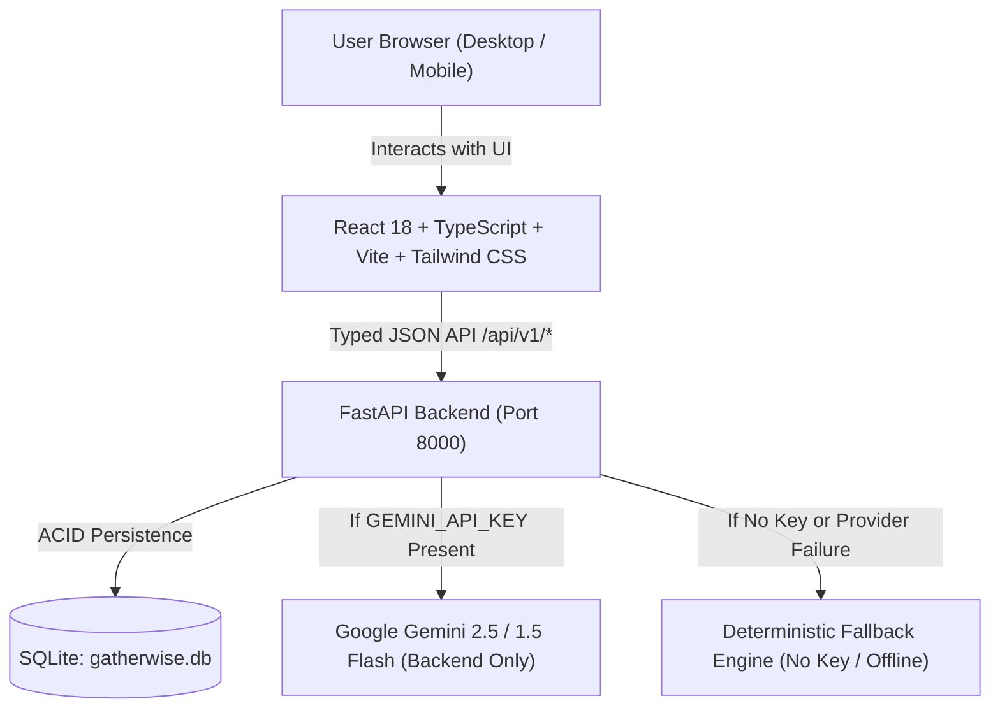

# GatherWise — Celebration & Event Planner
> **PromptWars Virtual Challenge 5: Celebration & Event Planner**  
> An intelligent, privacy-conscious event-planning assistant for organizing weddings, milestone birthdays, and community gatherings with deterministic budgets, phased timelines, vendor checklists, and tailored creative ideas.

---

## 🌟 Overview & Highlights

Planning high-stakes celebrations—such as weddings, milestone birthdays, and neighborhood festivals—is notoriously stressful due to fragmented checklists, budget drift, and unreliable estimations.

**GatherWise** bridges the gap between creative inspiration and financial rigor:
1. **Deterministic Budget Engine**: Calculates totals, variances, actual spending, and category distribution in pure verified code. Never trusts an LLM for arithmetic. Rejects negative, NaN, or infinite numbers.
2. **GenAI Structured Planning with Gemini**: Uses Google Gemini models behind a secure backend server to formulate tailored plans adhering strictly to schema rules.
3. **100% Offline Demo Mode**: Zero-configuration fallback generator that provides instant, high-fidelity plans for weddings, birthdays, and community events when no API key is provided or during provider outages.
4. **Targeted Section Regeneration**: Allows users to refine or re-roll a single section (e.g., cutting catering budget or shifting timeline) without wiping out manual modifications on other sections.
5. **Persistent Relational Storage**: Powered by SQLite with cascading cleanup; all edits, actual spend records, and task states survive page refreshes and server reboots.
6. **Multi-Format Export & Print**: Generates clean, printer-friendly PDF views, downloadable Markdown plans, and raw JSON data backups.
7. **Strict Security & Privacy**: API secrets stay exclusively on the backend; `.env` is git-ignored; CORS is locked down; zero secrets in frontend client bundles.

---

## 📐 Architecture



- **Frontend**: React 18, TypeScript, Vite, Tailwind CSS (warm editorial celebration aesthetic), Lucide React icons.
- **Backend**: FastAPI, Pydantic v2, Python 3.10+ (tested on Python 3.14.4).
- **Database**: SQLite (`gatherwise.db`) with relational foreign keys and cascading deletes.
- **AI Integration**: Google Gemini REST API with structured JSON output and bounded prompts.

---

## ☁️ Deployment on Render

GatherWise is ready for production deployment on [Render](https://render.com) using two separately managed services:
- **Backend Web Service**: Python 3 runtime hosting FastAPI on Render with health checks at `/api/v1/health`.
- **Frontend Static Site**: Built with Vite and served globally across Render's CDN.

👉 **Follow the complete, step-by-step setup guide:** **[DEPLOY_RENDER.md](DEPLOY_RENDER.md)**

---

## 🚀 Local Quickstart & Installation

### Prerequisites
- **Node.js**: v18+ (tested on v24.21.0)
- **Python**: 3.10+ (tested on Python 3.14.4)

### 1. Clone & Setup Backend
```bash
# From repository root:
python3 -m venv venv
source venv/bin/activate  # On Windows: venv\Scripts\activate
pip install -r backend/requirements.txt

# Configure environment:
cp .env.example .env
# Optional: Add your GEMINI_API_KEY to .env (GatherWise works 100% in Demo Mode without it!)
```

### 2. Start the Backend Server
```bash
PYTHONPATH=. ./venv/bin/uvicorn backend.app.main:app --host 127.0.0.1 --port 8000 --reload
```
API docs are available at `http://127.0.0.1:8000/docs`.

### 3. Setup & Start Frontend
In a new terminal:
```bash
cd frontend
npm install
npm run dev
```
Open **`http://127.0.0.1:5173`** in your browser.

---

## 🧪 Testing & Verification

GatherWise includes comprehensive backend and frontend test suites covering deterministic arithmetic, schema validation, fallback engines, API contracts, and user interactions.

### Run Backend Pytest Suite (24 tests)
```bash
PYTHONPATH=. ./venv/bin/pytest -v
```

### Run Frontend Component Tests (9 tests)
```bash
cd frontend
npm run test
```

### Run Frontend Typecheck & Production Build
```bash
cd frontend
npm run build
```

---

## 🔒 Security & Privacy

- **Protected Secrets**: `GEMINI_API_KEY` is loaded strictly in server-side memory from `.env`.
- **Git-Ignored**: `.env`, SQLite databases, logs, and `node_modules` are in `.gitignore`.
- **Frontend Audited**: Automated bundle scans verify no API keys or internal credentials exist in `frontend/dist`.
- **Normalized CORS**: Cross-Origin Resource Sharing is limited to configured host origins without trailing-slash vulnerabilities.
- **Input Boundaries**: Guest counts, budgets, and text fields are validated with explicit min/max bounds to prevent denial of service or injection.
- **Truth in Planning**: All checklists and prices are explicitly marked as planning estimates, not live bookings or real-time vendor reservations.

---

## 🎬 60-Second Demo Walkthrough

1. **Dashboard & Demo Seeding**: Launch the app. Click **"Explore Demo Celebrations"** to load three pre-computed events: *Elena & Mateo's Vineyard Wedding*, *Kai's 30th Milestone Neon Retro Bash*, and *Riverside Community Earth Day Fair*.
2. **Overview**: Click on the Vineyard Wedding. Observe the live countdown, target budget meter, checklist progress ring, and key milestone timeline.
3. **Deterministic Budget**: Switch to the **Budget & Costs** tab. Change the actual cost of "Ceremony & Reception Space Rental" to `$7,500`. Watch the Total Actual, Remaining Budget, and Variance recalculate instantly in deterministic code without page refresh.
4. **Targeted Regeneration**: Click **"Regenerate Budget"**. Enter a custom prompt such as *"Shift 10% more budget into live acoustic entertainment"*. Note that your previously recorded `$7,500` actual spend is preserved!
5. **Vendor Checklist**: Switch to the **Checklist** tab. Check off a task. Notice the persistent status update and the explicit booking disclaimer.
6. **Export**: Click **"Export / Print"** at top right. Select **"Print or Save as PDF"** to preview the clean printable layout, or click **"Download Markdown"** to save an offline report.

---

## 📄 License & Attribution
Built for the **PromptWars Virtual Challenge 5: Celebration & Event Planner**.  
Licensed under the [MIT License](LICENSE).
