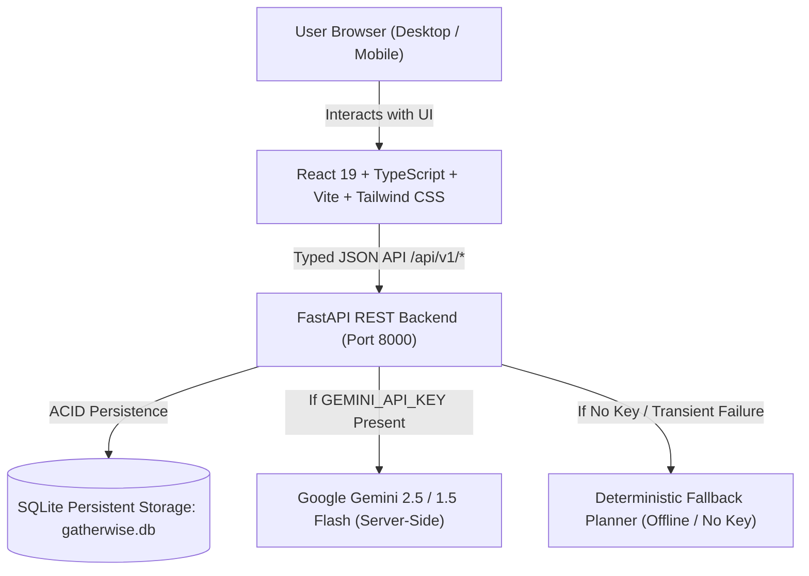

# GatherWise Architecture Specification

## Overview
GatherWise is an intelligent, privacy-conscious event-planning application designed for weddings, birthdays, community celebrations, and custom gatherings. It integrates deterministic domain computation (for budget accounting, date arithmetic, and milestone tracking) with GenAI structured planning (via Google Gemini models) and deterministic offline fallback mechanisms.

## System Components

### 1. Frontend (Client Layer)
- **Framework**: React 19 + TypeScript + Vite.
- **Styling**: Tailwind CSS with custom editorial design palette (warm stone, gold/amber accent, rose celebration tones, emerald completion accents), full responsive layout for mobile and desktop.
- **Icons**: Lucide React.
- **State & Data Flow**: React hooks, typed API client with centralized state synchronization, immediate optimistic UI feedback, and backend persistence.
- **Accessibility**: Semantic HTML5 elements (`main`, `nav`, `section`, `header`, `dialog`), ARIA tags (`aria-label`, `aria-live`, `aria-expanded`), high contrast ratios, and keyboard navigation.

### 2. Backend & API (Application Layer)
- **Framework**: FastAPI (Python 3.14) with Pydantic v2 schemas for high-performance validation and serialization.
- **Deterministic Math Core**: Budget calculations (totals, actuals, remaining budget, variance) and date calculations (countdown, milestone overdue status) are executed exclusively in verified deterministic code, rejecting NaN, negative values, and infinite numbers.
- **Security & Secrets**: Provider secrets (`GEMINI_API_KEY`) reside strictly in server environment memory and are never forwarded or exposed to the client.

### 3. AI Service & Structured Output
- **Model Adapter**: Supports Google Gemini models (e.g. `gemini-2.5-flash` or `gemini-1.5-flash`) via secure server-side REST API with response schema enforcement (`response_mime_type: "application/json"`).
- **Safety & Injection Defense**: User event descriptions, constraints, and priorities are safely demarcated in prompt boundaries, capped in size, and sanitized.
- **Deterministic Demo Fallback**: When `GEMINI_API_KEY` is not provided, or when network/provider errors occur, GatherWise seamlessly generates tailored, comprehensive, professional event plans without crashing or displaying empty screens.

### 4. Persistence Layer
- **Database**: SQLite (`gatherwise.db`), a zero-configuration, robust ACID relational database.
- **Storage Strategy**: Events, budget items, timeline milestones, checklist tasks, and creative ideas are persisted with relational keys and serialized plans to ensure full recovery across page refreshes.

## Production and Deployment Readiness
- **CORS**: Explicitly restricted to configured origins (no wildcard `*` allowed).
- **Exporting**: Multi-format exports including styled print layout, structured JSON backup, and formatted Markdown report.
